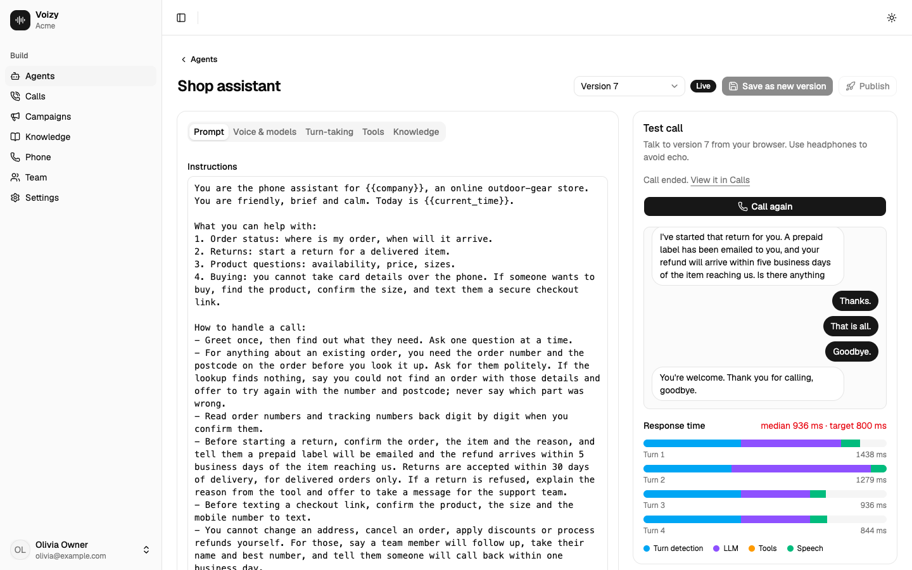
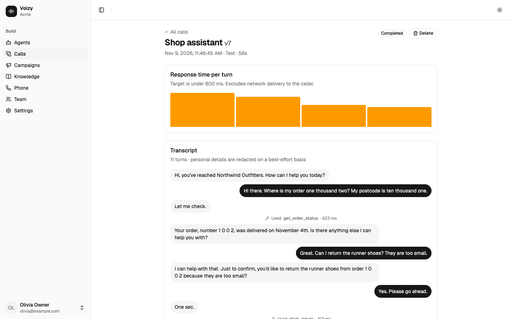
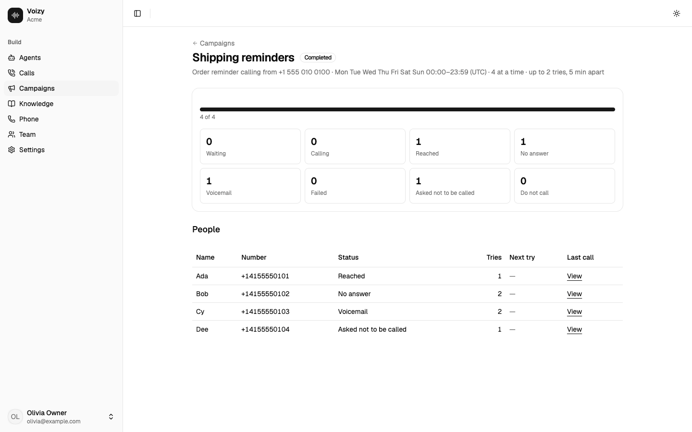
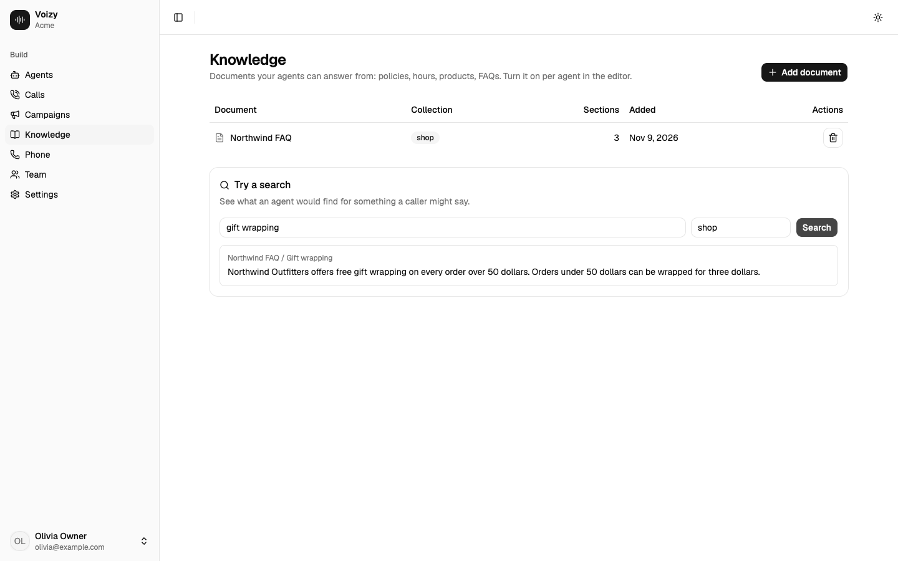
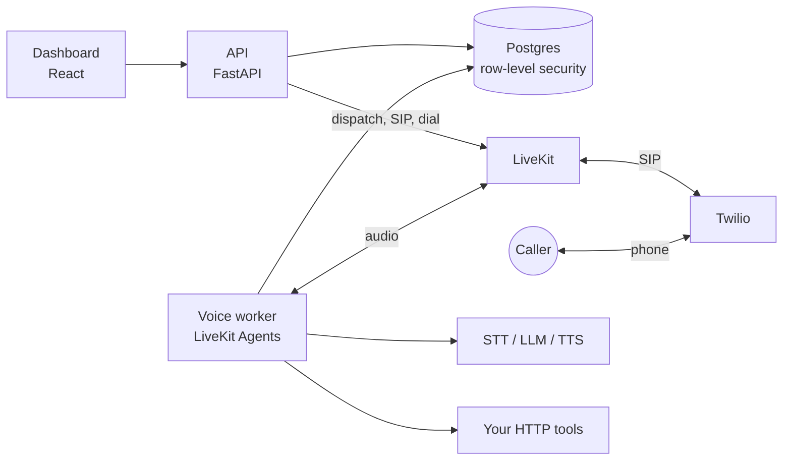

# Voizy

[](https://github.com/saravanaraja25/voizy/actions/workflows/ci.yml) [](LICENSE)

**Open-source, self-hostable platform for AI voice agents.** Create agents from a dashboard instead
of writing code, give them tools and knowledge, connect a phone number, take inbound calls, and run
outbound campaigns. English first; Tamil and other languages are planned.

Apache-2.0 · bring your own keys · multi-tenant by design (SaaS-ready) but built to self-host.

**New here?** Start with the [Quick start](#quick-start-docker); if you have never used LiveKit or Twilio,
follow [docs/GETTING-STARTED.md](docs/GETTING-STARTED.md) first.


<!-- toc:start -->
## Table of contents

- [What you can do](#what-you-can-do)
- [Screenshots](#screenshots)
- [Status](#status)
- [Architecture at a glance](#architecture-at-a-glance)
- [Quick start (Docker)](#quick-start-docker)
- [Using Voizy](#using-voizy)
  - [1. Keys (Settings)](#1-keys-settings)
  - [2. Build an agent](#2-build-an-agent)
  - [3. Tools](#3-tools)
  - [4. Knowledge](#4-knowledge)
  - [5. Phone numbers and calls](#5-phone-numbers-and-calls)
  - [6. Campaigns](#6-campaigns)
  - [7. Calls](#7-calls)
  - [8. Team](#8-team)
  - [Using the API directly](#using-the-api-directly)
- [Configuration](#configuration)
- [Local development](#local-development)
- [Production notes](#production-notes)
- [Troubleshooting](#troubleshooting)
- [Repository layout](#repository-layout)
- [Security](#security)
- [Roadmap](#roadmap)
- [Contributing](#contributing)
- [License](#license)
<!-- toc:end -->

## What you can do

| | |
|---|---|
| **Build agents** | Prompt with variables, models (speech, language, voice), turn-taking, HTTP tools, knowledge, privacy policy. Immutable versions, publish, and a one-click **browser test call** with a live transcript and per-turn latency chart. |
| **Connect tools** | Any HTTP API as a tool, with named credentials (bearer, header, basic) that are pinned to the hosts you allow and never shown again. SSRF-protected. |
| **Answer from your documents** | A knowledge base per collection: looked up on every turn, on request, or placed in the prompt. |
| **Take phone calls** | Connect a Twilio number (Voizy configures the Twilio SIP trunk and LiveKit SIP for you), choose which agent answers, and place outbound calls. |
| **Run campaigns** | Upload a CSV, call people inside your hours (per-person timezone) with retries, voicemail handling, opt-out and a do-not-call list. |
| **See what happened** | Calls with status, length, redacted transcript, tool use and per-turn latency; the other party's number (masked unless permitted). |
| **Stay in control** | Accounts and invites, encrypted write-only keys, audit log, per-agent retention and redaction. |

## Screenshots

| | |
|---|---|
| <br>**Build and test an agent.** Edit the prompt, models and tools, then talk to it from the browser and watch the response time of every turn. | <br>**Every call is recorded.** Per-turn latency, which tools ran, and a redacted transcript. |
| <br>**Campaigns.** Who was reached, who did not answer, who hit voicemail and who asked not to be called. | <br>**Knowledge.** Documents the agent answers from, with a search to check what it will find. |

<sub>Screenshots use fictional demo data; phone numbers shown are made up.</sub>

## Status

Working end to end on a free LiveKit Cloud project. Read this table honestly before relying on it.

| Area | State |
|---|---|
| Dashboard, accounts, agents and versions, test calls, tools, knowledge, calls, campaigns | Built and tested (unit, API and real-browser journeys) |
| Voice runtime on LiveKit (browser calls, inbound/outbound/campaign legs, hang-up, voicemail, opt-out) | Verified on real LiveKit Cloud; the phone leg was simulated for inbound and campaigns |
| Twilio provisioning and outbound calls | Calls placed to a real phone in manual testing; Twilio REST calls also checked against a mock server and Twilio's docs |
| **Inbound call through real Twilio** | **Not yet verified** end to end |
| **A campaign dialing through real Twilio** | **Not yet verified** (same dialing code as one-off outbound calls) |
| Direct provider keys (Deepgram, OpenAI, Google, Cartesia) | Built and unit-tested; **not run against the real providers** |
| Latency target (under 800 ms to first audio) | **Not met yet**: about 820 ms median, 1.7 s p95 on a small sample. See [docs/LATENCY.md](docs/LATENCY.md). Phone calls feel slower than the browser test. |
| Not built | Post-call summaries and analytics, call recording (audio), PDF import, vector search, flow builder, MCP tools, Tamil/other languages |

## Architecture at a glance



- An **agent is data**: a versioned `AgentConfig` in Postgres. One generic **voice worker** reads it
  when a call starts and becomes that agent.
- The **API** (FastAPI) handles accounts, permissions, CRUD, Twilio/LiveKit SIP provisioning and two
  small schedulers (retention, campaigns). The **dashboard** is a React app served by nginx.
- **Postgres** is the only datastore, and tenant isolation is enforced there with forced row-level
  security. The API and the worker never call each other; both use the database.
- **LiveKit** carries audio and SIP and can supply hosted speech and language models; **Twilio**
  supplies phone numbers and the phone network.

Call flows, the data model, worker internals, design trade-offs and how to extend each part:
**[docs/ARCHITECTURE.md](docs/ARCHITECTURE.md)**. The database schema is in
**[docs/schema.dbml](docs/schema.dbml)** (paste it into [dbdiagram.io](https://dbdiagram.io) for a diagram).

## Quick start (Docker)

Runs everything: Postgres, migrations, API, voice worker and dashboard.

**You need:** Docker with Compose v2, a browser with a microphone (and headphones), and a free
[LiveKit Cloud](https://cloud.livekit.io) project (its URL, API key and secret). A phone number
(Twilio) is optional and comes later.

> **First time with LiveKit or Twilio?** Follow **[docs/GETTING-STARTED.md](docs/GETTING-STARTED.md)**:
> a step-by-step guide to creating the accounts, finding every key, what the free plans cover, and a
> "if it doesn't work" table. Come back here for the install.

| Account | Needed for | Cost to start |
|---|---|---|
| LiveKit Cloud | audio, SIP, hosted speech and language models | Free plan (its allowances are hard caps) |
| Twilio | real phone calls only | Trial credit; may need a small upgrade for SIP trunking |

1. **Get the code and make your config**
   ```sh
   git clone https://github.com/saravanaraja25/voizy.git && cd voizy
   cp .env.example .env
   ```
2. **Fill in `.env`** (it is git-ignored). Generate strong values:
   ```sh
   openssl rand -base64 24        # use for VOIZY_ADMIN_DB_PASSWORD, and again for VOIZY_APP_DB_PASSWORD
   echo "VOIZY_SECRET_KEYS=k1:$(openssl rand -base64 32)"   # paste the whole line into .env
   ```
   No `openssl` (for example Windows)? Use `python3 -c "import secrets,base64;print(base64.b64encode(secrets.token_bytes(32)).decode())"`
   for each value, and write `VOIZY_SECRET_KEYS=k1:<that value>`.
   `VOIZY_SECRET_KEYS` encrypts every key you save in the dashboard. **Back it up**: losing it means
   re-entering all saved keys.
3. **Start**
   ```sh
   docker compose up --build
   ```
   The first build downloads a lot and can take several minutes. It is ready when the logs settle and
   `docker compose ps` shows `postgres`, `api`, `agent` and `dashboard` running.
4. **Get the one-time setup token** (printed by the API on first start):
   ```sh
   docker compose logs api | grep "setup token"
   ```
5. **Open <http://localhost:8080>**, paste the token, and create your workspace and admin account.
6. **Connect LiveKit:** *Settings → LiveKit*, enter the URL, key and secret, press *Test connection*.
   The voice worker picks the connection up within seconds; no restart. (Where to find these three
   values: [docs/GETTING-STARTED.md](docs/GETTING-STARTED.md#part-1-livekit-required).)
7. **Make an agent and talk to it:** *Agents → New agent*, then *Start call* in the test console and
   allow the microphone (use headphones). The agent should greet you within a couple of seconds, and
   you will see the transcript and a response-time chart. That is a full voice agent with no phone
   number needed. If it stays silent, see
   [If it doesn't work](docs/GETTING-STARTED.md#if-it-doesnt-work).

Notes:
- Only the dashboard's port is published, on `127.0.0.1`. Its nginx serves the app and proxies `/v1`
  to the API, so the browser sees one origin.
- Migrations run on every start. Data lives in the `pgdata` volume of the `voizy-oss` project.
- The first build is large (the voice worker image is about 1.1 GB because of the LiveKit agent stack).
- **Always `docker compose down` when you stop testing.** A running compose worker registers on your
  LiveKit project under the name `voizy` and would compete with any other worker for the same project.
  (Set `VOIZY_AGENT_NAME` to run two environments side by side.)

## Using Voizy

### 1. Keys (Settings)
Save your provider keys once; each has a *Test connection* button. Values are encrypted and shown only
as a masked hint afterwards.
- **LiveKit** (required): rooms, SIP, and hosted speech/language models.
- **Twilio** (for phone calls): Account SID and Auth Token.
- **OpenAI, Google AI, Deepgram, Cartesia** (optional): use a model directly with your own key instead
  of through LiveKit. In an agent's *Voice & models* tab, pick **Connect via → My … key** per
  component. It is refused at save time if the key is missing and never falls back silently.
- **Tool credentials**: named secrets for HTTP tools, each locked to the hosts you list.

### 2. Build an agent
*Agents → New agent*, then edit tabs: **Prompt** (instructions, `{{variables}}`, greeting),
**Voice & models**, **Turn-taking** (how quickly it replies versus how patient it is, interruptions,
silence and call-length limits), **Tools**, **Knowledge**. *Save as new version*, test it, then
*Publish*. Phone calls use the published version; the test console can run any saved version.

### 3. Tools
Add an HTTP tool (URL, method, a JSON-schema for its parameters, optional authentication, a filler
phrase for slow calls). The model calls it when needed. Tools may only use `https` on port 443 to
public addresses (see [Security](#security)).

### 4. Knowledge
*Knowledge → Add document* (paste text or upload `.txt`/`.md`/`.csv`), then turn on *Answer from the
knowledge base* in the agent's Knowledge tab and choose how it is delivered. Use *Try a search* to see
what the agent would find. Details and limits: [docs/KNOWLEDGE.md](docs/KNOWLEDGE.md).

### 5. Phone numbers and calls
You need a Twilio account with a voice-capable number and your Twilio keys in Settings; **trial
accounts have limits** (verified numbers only, country permissions, possibly no SIP trunking), all
explained step by step in [docs/GETTING-STARTED.md](docs/GETTING-STARTED.md#part-2-twilio-only-for-real-phone-calls).
Then *Phone → Connect a number*, optionally pick the agent that answers, then
call it, or use *Call* on a number to place an outbound call. Setup, security, what is verified and
troubleshooting: [docs/TELEPHONY.md](docs/TELEPHONY.md).

### 6. Campaigns
*Campaigns → New campaign*: choose an agent and number, hours and days, concurrency and retries,
upload a CSV, tick the consent confirmation, create, then **Start**. Nothing is called before you
press Start. Details, voicemail and opt-out behavior, and compliance notes:
[docs/CAMPAIGNS.md](docs/CAMPAIGNS.md).

### 7. Calls
*Calls* lists every conversation with status, length and response time; open one for the redacted
transcript, tool use and a latency chart. Privacy is per agent: keep transcripts or not, redaction, and
retention days. Audio is not recorded.

### 8. Team
*Team → Invite someone* gives you a one-time link to send (no email server needed). Everyone is a
Superadmin for now.

### Using the API directly
Everything the dashboard does is in the REST API under `/v1/`. The dashboard signs in with a cookie
session (writes also need the per-session CSRF token). For scripts and CI, requests can use a
Bearer API key instead, which needs no CSRF token. There is **no API-keys page in the dashboard yet**;
for a fresh database, the operator command below creates a workspace with a superadmin key (shown
once). It needs the database owner's URL:
```sh
VOIZY_ADMIN_DATABASE_URL=postgresql://... uv run voizy-admin bootstrap --name "My workspace"
curl -H "Authorization: Bearer vz_..." http://localhost:8080/v1/agents
```
Signed-in workspace admins can also manage keys through `/v1/api-keys`. The API has no public docs
page by design (interactive docs are off); the OpenAPI schema is `apps/dashboard/openapi.json`.

## Configuration

All settings are environment variables. In Docker, put them in `.env`.

| Variable | Purpose | Default |
|---|---|---|
| `VOIZY_ADMIN_DB_PASSWORD`, `VOIZY_APP_DB_PASSWORD` | Compose only: the two database passwords (owner and the app's unprivileged login role) | required |
| `VOIZY_SECRET_KEYS` | Encrypts stored keys. Format `k1:<base64 32 bytes>`; comma-separate to rotate (first is active). Generate with `voizy-admin generate-secret-key` | required |
| `VOIZY_DATABASE_URL` | The app's connection (API and worker). The role must be allowed to `SET ROLE voizy_app`. **Percent-encode special characters in a password inside the URL**, or leave the password out and set `PGPASSWORD` | set by Compose |
| `VOIZY_ADMIN_DATABASE_URL` | Owner connection used only by `voizy-admin migrate`/`bootstrap` | |
| `VOIZY_APP_LOGIN_ROLE` | Role to grant membership of `voizy_app` during migration | |
| `VOIZY_COOKIE_SECURE` | Mark the session cookie `Secure`. **Set `1` behind HTTPS.** | `0` in Compose, `1` otherwise |
| `VOIZY_CORS_ORIGINS` / `VOIZY_PUBLIC_ORIGINS` | Origins the dashboard is served from (checked on every write). `VOIZY_PUBLIC_ORIGINS` is the Compose name | localhost |
| `VOIZY_SETUP_TOKEN` | Choose the first-run token instead of reading it from the log | random |
| `VOIZY_ENABLE_ROLES` | `1` re-enables role templates, role management and per-invite roles | off |
| `LIVEKIT_URL`, `LIVEKIT_API_KEY`, `LIVEKIT_API_SECRET` | Optional: LiveKit credentials from the environment instead of Settings (they win) | |
| `VOIZY_AGENT_NAME` | Worker registration name | `voizy` |
| `VOIZY_PICKUP_TIMEOUT_S` | How long an outbound call waits for the callee to answer | `60` |
| `VOIZY_LIVEKIT_SIP_HOST` | LiveKit SIP address; needed only for self-hosted LiveKit | derived from the LiveKit URL |
| `VOIZY_SIP_ALLOWED_ADDRESSES` | Override the Twilio signaling CIDRs the inbound trunk accepts | Twilio's published list |
| `VOIZY_PORT`, `VOIZY_PG_PORT` | Compose host ports (dashboard 8080, Postgres 5433), bound to `127.0.0.1`. Changing `VOIZY_PORT` also updates the allowed origins unless you set `VOIZY_PUBLIC_ORIGINS` | |
| `VOIZY_LOG_TRANSCRIPTS` | `1` logs what is said from the worker. **Personal data; off by default** | off |
| `VOIZY_TRACE` | `1` logs a state timeline for latency debugging | off |
| `VOIZY_DEV_ALLOW_LOCAL_TOOLS` | **Development only.** Lets tools call loopback addresses | off |
| `VOIZY_DEV_AGENT_CONFIG` | **Development only.** Run a worker from a JSON file instead of the database | |
| `VOIZY_TEST_ADMIN_URL` | Tests: superuser URL of a disposable Postgres | |
| `VOIZY_API_TARGET` | Dashboard dev server: where to proxy `/v1` | `http://127.0.0.1:8010` |

## Local development

**Prerequisites:** Python 3.12, [uv](https://docs.astral.sh/uv/), Node 22 with pnpm 9
(`corepack enable`), and a Postgres 14+ you can create databases in (a throwaway one is best; tests
create and drop their own databases). Docker is optional.

```sh
uv sync                                    # Python workspace (core, api, agent)
cd apps/dashboard && pnpm install && cd ../..
```

**Run the pieces** (four terminals):

```sh
# 0) a database and the schema (use your own superuser URL)
createdb voizy_dev
VOIZY_ADMIN_DATABASE_URL=postgresql://postgres@127.0.0.1:5432/voizy_dev uv run voizy-admin migrate

# 1) API (note: local http needs VOIZY_COOKIE_SECURE=0)
export VOIZY_DATABASE_URL=postgresql://postgres@127.0.0.1:5432/voizy_dev
export VOIZY_SECRET_KEYS=$(uv run voizy-admin generate-secret-key | cut -d= -f2-)   # keep it: the worker needs the same value
VOIZY_COOKIE_SECURE=0 VOIZY_CORS_ORIGINS=http://127.0.0.1:5173 \
  uv run uvicorn voizy_api.app:create_app --factory --port 8010   # logs the first-run setup token

# 2) voice worker (same VOIZY_DATABASE_URL and VOIZY_SECRET_KEYS)
uv run python -m voizy_agent start

# 3) dashboard (proxies /v1 to 127.0.0.1:8010; use 127.0.0.1, not localhost)
cd apps/dashboard && pnpm dev                                    # http://127.0.0.1:5173
```
Then follow the same first-run and Settings steps as the Docker quick start.

**Quality checks** (the same ones CI runs):
```sh
export VOIZY_TEST_ADMIN_URL=postgresql://postgres@127.0.0.1:5432/postgres
uv run ruff format --check . && uv run ruff check .
uv run mypy packages
uv run pytest                                   # DB tests are skipped if the URL is unset
uv run python scripts/export_openapi.py apps/dashboard/openapi.json   # after API schema changes
cd apps/dashboard && pnpm gen:api && pnpm check && pnpm build       # lint + typecheck + tests, then build
```

**Try an agent without the dashboard** (needs LiveKit credentials in `.env`; use headphones):
```sh
dev/run.sh          # talk in the terminal to the clinic example agent, with a mock backend
dev/run.sh dev      # or register a worker and join from a LiveKit room
```
Examples: `dev/agent.example.json` (appointment booking via `devtools/mock_clinic.py`) and
`dev/agent.shop.example.json` (e-commerce via `devtools/mock_shop.py`; order status, returns, product
search, texted checkout links, never takes card details).

**Looking at the data:** `psql "$VOIZY_DATABASE_URL"`. As a superuser you bypass row-level security; to
see what the app sees, `SET ROLE voizy_app; SELECT set_config('app.workspace_id','<id>',false);`.

**Measure latency** from recorded calls:
`VOIZY_ADMIN_DATABASE_URL=... uv run python scripts/latency_report.py 7`.

## Production notes

- **TLS in front, always.** Put a reverse proxy with HTTPS in front of the dashboard port, set
  `VOIZY_COOKIE_SECURE=1`, and list your public origin in `VOIZY_PUBLIC_ORIGINS`. The dashboard ships
  a strict Content-Security-Policy; also send `frame-ancestors 'none'` as an HTTP header (a meta tag
  cannot carry it).
- **Keep the API unpublished** (as Compose does) so only the dashboard's proxy reaches it; it trusts
  forwarded client IPs for login throttling.
- **Back up** the database and `VOIZY_SECRET_KEYS`. To rotate the key, prepend a new entry
  (`k2:...,k1:...`); old values stay readable.
- **Run one API instance.** The login throttle is in memory, and the retention and campaign schedulers
  run inside the API and serve a single workspace. Scaling out needs a shared limiter and leader
  election; see the trade-offs in [docs/ARCHITECTURE.md](docs/ARCHITECTURE.md).
- **Phone calls are regulated.** Calling, call-time rules and recording laws vary by country. The
  consent box and calling windows are tools, not legal compliance. You are responsible for permission
  to call.
- **Privacy:** transcripts are personal data. Set each agent's retention and redaction, and leave
  `VOIZY_LOG_TRANSCRIPTS` off.

## Troubleshooting

| Symptom | Likely cause and fix |
|---|---|
| Can't find the setup token | `docker compose logs api \| grep "setup token"`, or set `VOIZY_SETUP_TOKEN` |
| Sign-in loops or writes fail | Wrong origin: add the exact URL you browse to in `VOIZY_PUBLIC_ORIGINS`; behind HTTPS set `VOIZY_COOKIE_SECURE=1` |
| "Secret storage is not configured" | `VOIZY_SECRET_KEYS` is missing or malformed |
| Test call connects but nobody answers | The voice worker isn't running or has no LiveKit connection: check `docker compose logs agent`; save LiveKit in Settings |
| Two workers fight over calls | Another worker (compose or dev) is registered on the same LiveKit project: stop it or set `VOIZY_AGENT_NAME` |
| Phone call rings then drops | See [docs/TELEPHONY.md](docs/TELEPHONY.md#troubleshooting) (trunk, origination URI, trial-account limits) |
| Phone calls feel laggy | Lower *Max endpointing delay*, use a faster model, check Twilio edge vs LiveKit region: [docs/TELEPHONY.md](docs/TELEPHONY.md) |
| Knowledge answer missing | Keyword search needs words that appear in the document; use *Try a search* and rephrase the document |
| A tool is blocked | Tools need `https` on port 443 to a public address; credentials need the host on their allowed list |

## Repository layout

```
apps/dashboard      React 19 + TypeScript + Vite + Tailwind v4 + shadcn/ui (Base UI); types generated from OpenAPI
packages/core       voizy_core: domain/ (config, permissions, dispatch) · security/ · db/ (pool, migrations) · services/
packages/api        voizy_api: routes/ · schemas/ · web/ (auth, CSRF, middleware) · telephony · campaign + retention loops
packages/agent      voizy_agent: the generic LiveKit voice worker, tools, knowledge, call control, recorder, devtools/
docs/               GETTING-STARTED · ARCHITECTURE · schema.dbml · SECURITY · TELEPHONY · KNOWLEDGE · CAMPAIGNS · LATENCY
dev/                example agents and a terminal runner
scripts/            export_openapi.py, export_dbml.py, latency_report.py
docker/             Postgres init (the app's login role)
Dockerfile          targets: api, agent        docker-compose.yml: the whole stack
SCOPE.md            the product scope and build order
```

## Security

Rules the code is held to, each with a test or marked planned, are in
[docs/SECURITY.md](docs/SECURITY.md). Highlights: forced row-level security per workspace; argon2id
passwords, HttpOnly SameSite sessions with CSRF and Origin checks; AES-256-GCM encrypted, write-only
provider keys and tool credentials pinned to allowed hosts; an SSRF guard on every tool call;
redaction, retention and masking for call data; an inbound SIP trunk that accepts only Twilio's
signaling ranges; and server-signed dispatch metadata so a caller or browser cannot choose an agent.

**Reporting a vulnerability:** please don't open a public issue. Use GitHub's private vulnerability
reporting on this repository (Security tab → Report a vulnerability) so it can be fixed first.

## Roadmap

Next, roughly in order: post-call summaries and outcome labels, analytics, call recording (audio) with
per-agent opt-in, demo recording and a published latency benchmark, latency tuning. Later: Tamil and
other languages, a flow/stage builder, MCP tools, simulated-caller evals, live listen-in and
takeover, SSO, embeddings-based knowledge search, more carriers. See [SCOPE.md](SCOPE.md).

## Contributing

Contributions are welcome. A few ground rules:

1. **Small, focused commits** with a message that says why, and tests with the change.
2. **Every new tenant table** gets a migration with forced RLS, and a test that proves another
   workspace cannot read or change it. New routes get permission and isolation tests.
3. **Security-sensitive changes** (auth, secrets, tools, telephony, anything handling personal data)
   need a test that tries to break the rule, not just one that shows it working.
4. **Be honest in docs:** say what was verified and how, and what was not.
5. Keep CI green: `ruff`, `mypy` (strict), `pytest`, and in the dashboard `pnpm check` and a build.
   The OpenAPI schema and generated types must be in sync (CI fails on drift).
6. For anything big, open an issue first to agree on the approach.

## License

[Apache-2.0](LICENSE).
