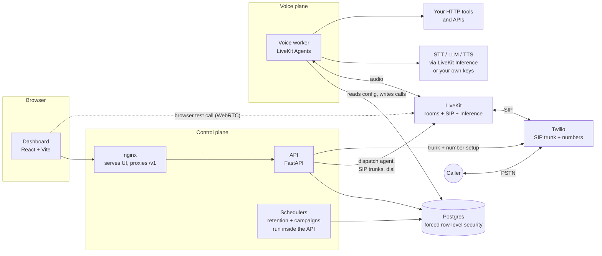
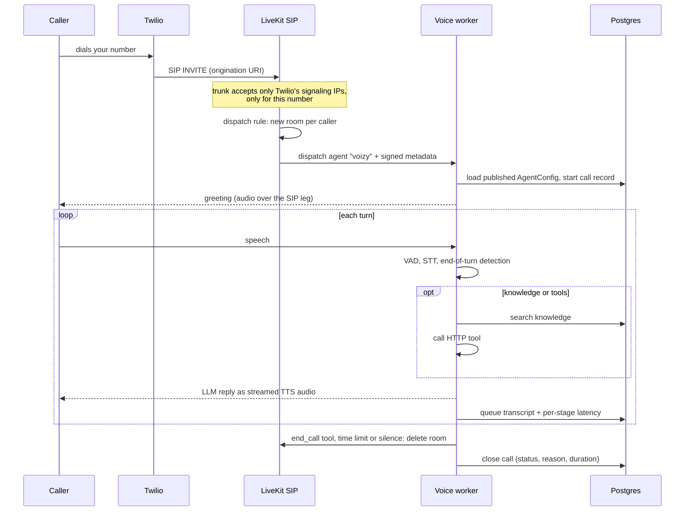

# Architecture

How Voizy is put together, why, and where to extend it. For what is verified and what is not, see the
status tables in the [README](../README.md); for security rules see [SECURITY.md](SECURITY.md).

<!-- toc:start -->
## Table of contents

- [The idea](#the-idea)
- [Components](#components)
- [A call, end to end](#a-call-end-to-end)
- [Data model](#data-model)
- [Inside the voice worker](#inside-the-voice-worker)
- [Security boundaries (summary)](#security-boundaries-summary)
- [Design decisions and trade-offs](#design-decisions-and-trade-offs)
- [Extending Voizy](#extending-voizy)
<!-- toc:end -->

## The idea

An **agent is data, not code**. Everything that makes one agent different from another (prompt,
variables, models, voice, turn-taking, tools, knowledge, policy) is a versioned `AgentConfig`
stored in Postgres. One generic **voice worker** reads that config when a call starts and turns
itself into that agent. A **control plane** (API + dashboard) edits the configs, connects phone
numbers, runs campaigns and shows what happened. Audio never goes through the API.

## Components



| Piece | Code | Responsibility |
|---|---|---|
| **Dashboard** | `apps/dashboard` | Accounts, agent editor, test console, calls, phone numbers, campaigns, knowledge, settings. Types are generated from the API's OpenAPI schema, so they cannot drift. |
| **API** | `packages/api` (`voizy_api`) | Authentication, permissions, CRUD for everything, provisioning Twilio and LiveKit SIP, minting test-call tokens, the retention and campaign schedulers. |
| **Voice worker** | `packages/agent` (`voizy_agent`) | One entrypoint. Loads the agent config, builds the STT→LLM→TTS pipeline, runs tools and knowledge lookups, records the call, hangs up. |
| **Core** | `packages/core` (`voizy_core`) | Domain models, security primitives, database schema, and the services both API and worker use. No web or audio code. |
| **Postgres** | `db/migrations` | The only datastore. Tenant isolation is enforced here, not in application code. |
| **LiveKit** | external | Real-time rooms, SIP gateway, and (optionally) hosted speech and language models. |
| **Twilio** | external | Phone numbers and the PSTN connection, via an Elastic SIP trunk. |

The worker never talks to the API; both talk to Postgres. That keeps the voice path independent of
the web tier, so a dashboard deploy cannot drop a call.

## A call, end to end

### Browser test call

1. The dashboard asks the API for a test session for an agent version.
2. The API mints a short-lived LiveKit token that joins a fresh room and **requests the agent inside
   the token**, with metadata (workspace, agent, version) that the API signs. A browser cannot pick a
   different agent or workspace.
3. LiveKit dispatches the worker named `voizy`; the worker parses the metadata strictly (UUIDs only),
   loads exactly that version, and starts the session.

### Inbound phone call



### Outbound call and campaigns

A one-off call (`POST /v1/calls/outbound`) or the campaign scheduler asks LiveKit to dispatch the
agent into a new room and then to dial out through the number's outbound SIP trunk (Twilio
termination, credential-authenticated). The agent waits for the callee to pick up (up to
`VOIZY_PICKUP_TIMEOUT_S`) before speaking, learns the number and the contact's variables from the
signed dispatch metadata, and gets voicemail and opt-out tools. A call nobody answers is recorded as
failed with the reason "not answered".

The campaign scheduler is a small loop in the API. Each tick, per running campaign: turn finished
calls into contact outcomes, claim the contacts that are due (calling day and window in the
contact's own timezone, not on the do-not-call list, within the concurrency limit; all decided in
SQL with `FOR UPDATE SKIP LOCKED`), dial them, and close the campaign when nobody is left.

## Data model

Every tenant table carries `workspace_id`, has row-level security enabled **and forced**, and uses
composite foreign keys `(workspace_id, id)` so one tenant cannot reference another's rows.

| Area | Tables |
|---|---|
| Tenancy and access | `workspaces`, `users`, `memberships`, `roles`, `role_permissions`, `api_keys`, `sessions`, `invites`, `instance_settings` |
| Agents | `agents`, `agent_versions` (immutable once published) |
| Secrets | `secrets` (AES-GCM ciphertext; kinds: integration keys vs tool credentials) |
| Calls | `calls`, `call_turns` (transcript, tool name and outcome only, per-stage latency) |
| Telephony | `telephony_trunks`, `phone_numbers` |
| Knowledge | `kb_documents`, `kb_chunks` (full-text index) |
| Campaigns | `campaigns`, `campaign_contacts`, `dnc_numbers` |
| Audit | `audit_log` |

Migrations are plain SQL in `packages/core/src/voizy_core/db/migrations/`, applied in order by
`voizy-admin migrate`.

**Schema diagram:** [`schema.dbml`](schema.dbml) is the full schema (columns, keys, indexes, checks,
row-level-security flags). Paste it into [dbdiagram.io](https://dbdiagram.io) (*Import → DBML*) for an
interactive diagram. It is generated from the migrated database, not written by hand; regenerate it
after adding a migration:

```sh
VOIZY_ADMIN_DATABASE_URL=postgresql://... uv run python scripts/export_dbml.py docs/schema.dbml
```

### Tenant isolation

- The app connects as an unprivileged role that is a member of `voizy_app`, which cannot bypass RLS.
- Each transaction sets `app.workspace_id` with `set_config(..., true)` (transaction-local); a
  missing setting means zero rows.
- Service functions use `owned_tx`, which refuses to run inside an already-open transaction. A nested
  savepoint would not commit and would leak the security context into the next query.

### Versions

Saving an agent creates a new immutable version; **publish** points the agent at one. Phone calls
(inbound, outbound, campaigns) use the published version; the dashboard test console can run any
saved version, including drafts. A database trigger forbids changing a published version.

## Inside the voice worker

- **Pipeline:** Silero VAD → streaming STT → LiveKit's turn detector (end-of-turn) → LLM → streaming
  TTS, with barge-in. Each component is built per agent from its config.
- **Providers:** each of STT, LLM and TTS connects through **LiveKit Inference** (one LiveKit key
  for everything) or **directly with your own key** (Deepgram, OpenAI, Google, Cartesia). Choosing
  your own key never silently falls back to LiveKit.
- **Tools:** HTTP tools are called by the model. The executor is SSRF-guarded (https only, port 443,
  global IPs only, IP pinning, no redirects, size and time caps) and injects a named credential only
  after the destination passes and is on the credential's allowed-hosts list. Built-in tools:
  `end_call`; on outbound calls `voicemail_detected` and `opt_out_of_calls`; optionally
  `search_knowledge`.
- **Fillers:** while a slow tool runs, a short holding phrase is spoken so the line is not silent.
- **Knowledge:** per-turn prefetch, a search tool, or the whole collection in the prompt.
- **Instructions:** the builder's prompt, then (phone calls) a "This call" block with the other
  party's number and direction, then knowledge text, then **non-negotiable call rules last** so they
  outweigh anything earlier.
- **Call control:** the agent hangs up through `end_call`, and the worker enforces
  `max_call_duration_s` and `max_silence_s`. Hang-up deletes the LiveKit room, which also drops a
  phone leg.
- **Recording:** a bounded queue and one background writer. The audio path only enqueues; any
  database failure is logged without content and dropped. Redaction, transcript opt-out and
  retention follow the agent's `policy`.
- **Config loading:** the worker resolves the agent from dispatch metadata, reads credentials per
  workspace from the encrypted store, and (on start) waits for a LiveKit connection to be saved in
  the dashboard, so a fresh deployment needs no restart.

## Security boundaries (summary)

Browser ↔ API: HttpOnly SameSite cookie + per-session CSRF token + Origin allowlist, argon2id
passwords, throttled login. API ↔ database: forced RLS. Worker ↔ internet: SSRF guard. Secrets:
encrypted at rest, write-only through the API. Telephony: inbound trunk allowlists Twilio's
signaling IPs; dispatch metadata is server-signed. Full list with tests: [SECURITY.md](SECURITY.md).

## Design decisions and trade-offs

| Decision | Why | Cost |
|---|---|---|
| One generic worker driven by config | Any use case from the dashboard; no per-agent deploys | The runtime must be general; per-agent code is not possible |
| Postgres for everything (incl. RLS, queues, scheduler) | One dependency; self-hosting stays simple; isolation enforced in the database | Not built for very large scale; schedulers are single-instance |
| Postgres full-text search for knowledge | No extension, key or extra service; milliseconds | Keyword, not semantic, matching |
| Campaign scheduler as an API loop, not Temporal | Fewer moving parts for self-hosters | Single instance, primary workspace only |
| LiveKit for media and SIP | Mature agent framework, SIP, hosted models | Tied to LiveKit; Twilio-only carrier today |
| Immutable published versions | Safe rollbacks and audit; a call always knows exactly what ran | More rows; edits become new versions |
| Roles scoped to a single Superadmin by default | Simplest correct start | Custom roles exist in code (`VOIZY_ENABLE_ROLES=1`) but are off |

## Extending Voizy

- **A new permission:** add it to `Permission` in `domain/permissions.py`, check it with
  `require(Permission.X)` on the route, and add a test. Roles are data; permissions are code.
- **A new database table:** add a migration (next number), enable and **force** RLS with the
  `tenant_isolation` policy, grant only what the app needs to `voizy_app`, and use `owned_tx` +
  `set_local("app.workspace_id", ...)` in the service.
- **A new model provider:** add a branch in `voizy_agent/providers.py` (`WorkspaceProviders`), the
  provider and key name in `domain/direct.py`, and the integration in `domain/integrations.py`.
- **A new built-in tool:** write it in `voizy_agent/call_control.py` or `tools.py`, register it in the
  worker entrypoint, add its name to the instruction rules, and test it.
- **A new language:** language is data (`AgentConfig.languages`, per-language STT/voice and
  greeting). Tamil and others are phase 2: provider support and tuning are the work, not a rewrite.
- **A dashboard page:** add the route in `App.tsx`, a nav entry guarded by a permission, regenerate
  types with `pnpm gen:api` after backend changes, and add a test with the fetch mock harness.
